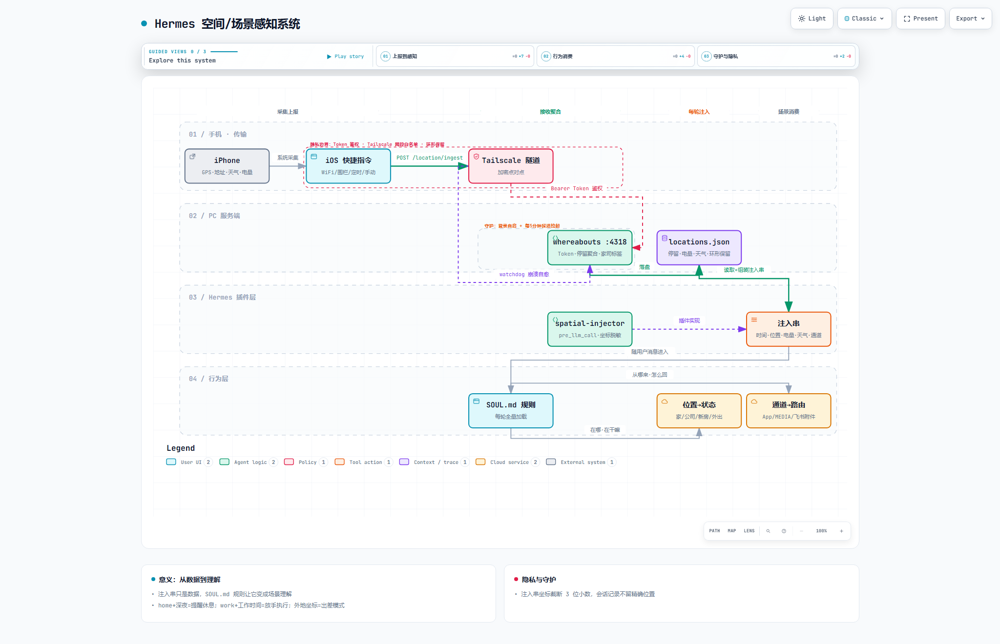

# Hermes Spatial Awareness 空间/场景感知系统

> 让你的 AI 助手知道你在哪、在干嘛、从哪个设备说话——每轮对话自动携带时间、位置、天气、电量与消息通道。

[](LICENSE)

English | [文档](docs/DESIGN.md)

## 它解决什么问题

AI 助手看不到你的现实世界。这套系统给 Hermes Agent 装上「空间眼睛」：

| 场景 | 没有空间感知 | 有了空间感知 |
|------|-------------|-------------|
| ☔ 下雨的早晨 | 你问天气它才查 | 主动提醒「今天有雨，出门带伞」 |
| 🌙 深夜在家 | 你催任务它就赶 | 「23 点啦，早点睡，任务明天继续」 |
| 💼 工作时间 | 所有请求一视同仁 | 工作任务可放手推进 |
| ✈️ 旅行到新城市 | 你问攻略它才搜 | 主动介绍附近的本地好店 |
| 📱 换设备聊天 | 文件投递方式靠猜 | 手机 App 自动走附件直投 |


## 工作原理

```
iPhone 快捷指令（WiFi切换/地理围栏/定时/手动触发）
    │ POST 位置+地址+天气+电量（Bearer Token）
    ▼
Tailscale 加密隧道（免公网暴露）
    ▼
whereabouts-mcp 服务 :4318（停留聚合 · 家/公司语义标签）
    ▼
locations.json（环形保留，不做轨迹库）
    ▼
spatial-injector 插件（Hermes pre_llm_call hook）
    │ 每轮组装注入串（坐标脱敏至 3 位小数）
    ▼
[Current context: 时间 | Location: home · 已停留2h · 天气 | Channel: hermespilot]
    ▼
SOUL.md 行为规则 → 场景化回复
```



## 组件

| 组件 | 说明 | 来源 |
|------|------|------|
| `whereabouts-mcp` | 位置接收服务（含 weather 字段补丁） | 基于 [WenXiaoWendy/whereabouts-mcp](https://github.com/WenXiaoWendy/whereabouts-mcp) (AGPL-3.0) |
| `plugin/` | spatial-injector 注入插件（MIT） | 本仓库原创 |
| `scripts/` | Windows 部署脚本（启动+watchdog 守护） | 本仓库原创 |
| `docs/DESIGN.md` | 完整设计文档（含决策记录与隐私边界） | 本仓库 |

## 快速开始

### 前置要求

- Windows 10/11 + Node.js ≥ 22
- [Tailscale](https://tailscale.com/)（免费档够用）组网你的手机与电脑
- iPhone（快捷指令 App）
- Hermes Agent（[nousresearch/hermes-agent](https://github.com/nousresearch/hermes-agent)）

### 1. 部署接收服务

```powershell
git clone https://github.com/WenXiaoWendy/whereabouts-mcp.git
cd whereabouts-mcp && npm install
```

创建 `.env`（**真实坐标只存这里，不要提交到任何仓库**）：

```ini
WHEREABOUTS_TOKEN=<自己生成一个随机长字符串>
WHEREABOUTS_HOME_CENTER=31.xxxxxx,121.xxxxxx
WHEREABOUTS_WORK_CENTER=31.xxxxxx,121.xxxxxx
WHEREABOUTS_STATE_DIR=<你的状态目录>
WHEREABOUTS_HOST=0.0.0.0
WHEREABOUTS_PORT=4318
```

修改 `scripts/start-whereabouts.cmd` 顶部的两个路径变量，然后：

```powershell
# 自测
curl http://127.0.0.1:4318/healthz

# 模拟上报
curl -X POST http://127.0.0.1:4318/location/ingest -H "Authorization: Bearer <TOKEN>" -H "Content-Type: application/json" -d "{\"latitude\":31.12,\"longitude\":121.45,\"trigger\":\"manual\",\"batteryLevel\":80}"
```

### 2. 注册开机自启 + 守护

```powershell
schtasks /Create /TN "Whereabouts_Location_Service" /TR "<路径>\scripts\watchdog.cmd" /SC MINUTE /MO 5 /RL HIGHEST /F
```

watchdog 每 5 分钟探活一次 `healthz`，进程崩溃自动拉起（≤5 分钟自愈）。

> ⚠️ Windows 坑：`.cmd` 脚本必须 ASCII-only——UTF-8 中文注释会被 GBK cmd 误读为命令。

### 3. 安装 Hermes 插件

```powershell
# 复制到 Hermes 插件目录
xcopy /E /I plugin "%HERMES_HOME%\plugins\spatial-injector\"
# 默认从 ~/.spatial-awareness/locations.json 读状态；或设置环境变量 SPATIAL_STATE_FILE 指向 whereabouts 的 locations.json
# 重启 Hermes 生效
```

### 4. 配置 iPhone 快捷指令

新建快捷指令「上报位置」：

| 动作 |
|------|
| 获取当前位置（精确度：最佳） |
| 获取 URL 内容 `http://<电脑Tailscale IP>:4318/location/ingest`，方法 POST，头部 `Authorization: Bearer <TOKEN>`，请求体 JSON：`latitude`←纬度、`longitude`←经度、`address`←当前地址、`batteryLevel`←电池电量、`trigger`=manual、`deviceName`=设备名称 |

建议的自动化触发器：加入/离开家庭 WiFi（trigger=arrive_home/leave_home）、到达/离开公司（trigger=arrive_work/leave_work）、定时兜底、手动按钮。

### 5. 验收

- [ ] 手机上报后 `locations.json` 出现 currentStay
- [ ] 无 Token 请求返回 401
- [ ] 重启 Hermes 后对话自动携带 `[Current context: ...]`
- [ ] 家/公司坐标各上报一次，placeTag 自动打标签

## 隐私设计

- **单向主动上报**，不是追踪器——快捷指令删了即停
- **传输**：仅 Tailscale 网段 + Bearer Token（配合防火墙白名单可做到公网不可达）
- **存储**：本地 JSON 环形保留（20 条停留/100 条电量），无云端、无轨迹库
- **注入脱敏**：进入 AI 对话记录的坐标截断至 3 位小数（~110m）
- **撤销**：停服务 + 删插件即完全移除

## 已知坑（帮你踩过了）

- `.cmd` 脚本含 UTF-8 中文注释会被 GBK cmd 误读执行——保持 ASCII
- 不要用 LocalSystem/NSSM 跑 whereabouts——`~` 会解析到 systemprofile 导致状态文件路径分裂，用 S4U 计划任务 + 显式 `WHEREABOUTS_STATE_DIR`
- `durationMinutes`/`batteryLevel` 不在状态文件的 stay 里（README 写的是 MCP 输出时计算），消费侧需自行推导
- iOS 快捷指令后台触发偶发不执行——多触发器冗余（WiFi+围栏+定时）

完整决策记录与架构演进见 [docs/DESIGN.md](docs/DESIGN.md)。

## License

- `plugin/`、`scripts/`、`docs/`：MIT
- whereabouts-mcp 上游：AGPL-3.0（本仓库未修改其源码，独立进程部署；如需 weather 字段落库能力，参考上游仓库提 PR）

## 致谢

- [WenXiaoWendy/whereabouts-mcp](https://github.com/WenXiaoWendy/whereabouts-mcp) — 优雅的位置上下文服务
- [Nous Research](https://github.com/nousresearch/hermes-agent) — Hermes Agent 与插件系统
- [HermesPilot](https://github.com/) — 手机端通道

---
*Built with Hermes Agent · 2026-10*
